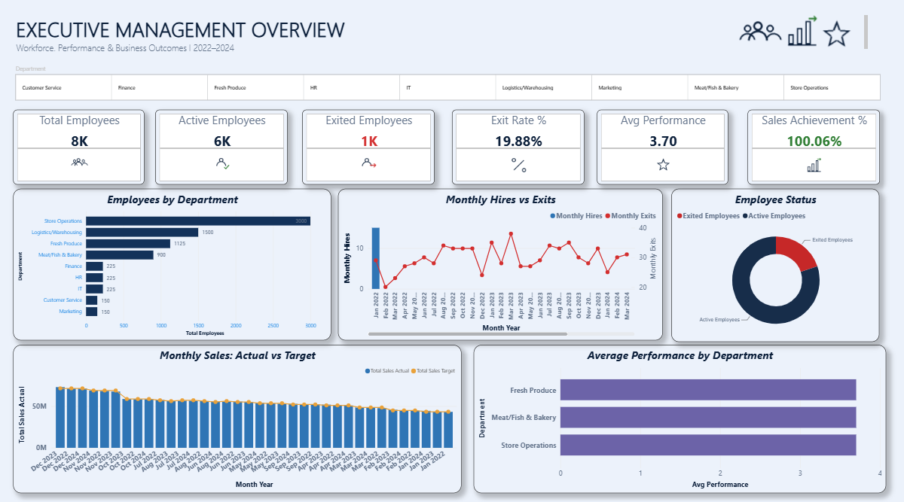
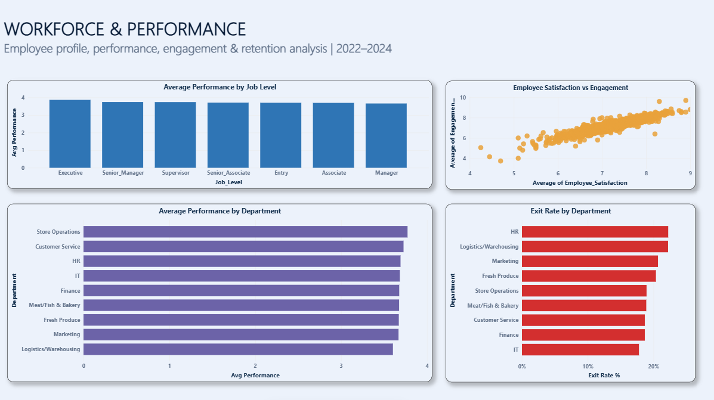
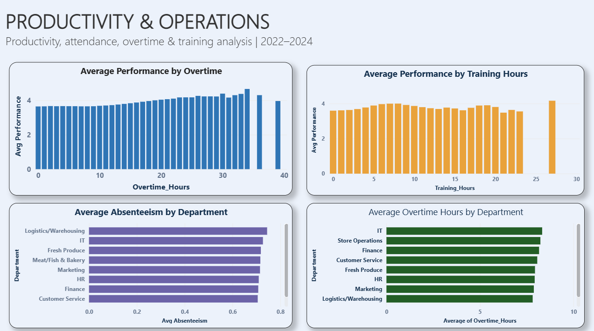
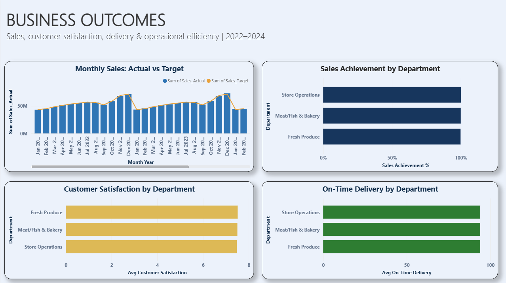

# Workforce & Operations Performance Analytics



An end-to-end Data Analytics project focused on workforce performance, employee engagement, productivity, retention, and business outcomes.

## Project Overview

This project analyzes workforce and operational data across 2022–2024 to support management decision-making. The analysis combines employee data, monthly performance records, role KPIs, store information, and business outcomes.

The project follows an end-to-end analytics workflow:

**Data Preparation → SQL Analysis → Python EDA → Power BI Dashboard → Business Insights → Management Recommendations**

## Business Objectives

- Understand workforce distribution across departments and job roles
- Analyze employee performance, satisfaction, and engagement
- Examine patterns related to tenure, overtime, training, and absenteeism
- Analyze employee exits and retention patterns
- Evaluate sales achievement and operational KPIs
- Provide management-focused insights and recommendations

## Tools & Technologies

- **Excel** — data review and preparation
- **SQL** — business analysis and KPI queries
- **Python** — exploratory data analysis
- **Pandas & NumPy** — data manipulation and analysis
- **Matplotlib** — visualization
- **Power BI** — interactive dashboard and management reporting

## Dataset

The project uses a workforce analytics dataset containing:

- Employee information
- Store information
- Monthly employee performance
- Role-level KPIs
- Business outcomes

Analysis covers **January 2022 to December 2024**.

## Power BI Dashboard

### 1. Executive Management Overview

Provides a management-level summary of:

- Total, active, and exited employees
- Exit rate
- Average performance
- Sales achievement
- Workforce distribution
- Monthly hiring and exit trends
- Sales actual vs target
- Performance by department


### 2. Workforce & Performance

Focuses on:

- Performance by job level
- Employee satisfaction and engagement
- Performance by department
- Exit rate by department



### 3. Productivity & Operations

Analyzes:

- Overtime and performance
- Training and performance
- Absenteeism by department
- Overtime hours by department



### 4. Business Outcomes

Analyzes:

- Monthly sales actual vs target
- Sales achievement by department
- Customer satisfaction
- On-time delivery



## Key Findings

- **Workforce concentration:** Store Operations is the largest department, representing approximately 40% of the workforce, followed by Logistics/Warehousing at approximately 20%.
- **Employee retention:** The overall observed employee exit rate is approximately **19.88%**, highlighting retention as an important management area.
- **Sales performance:** Overall sales achievement is approximately **100.06%** against target, indicating that aggregate sales performance is closely aligned with planned targets.
- **Performance & management evaluation:** Manager Evaluation has a strong positive association with employee Performance Rating (**correlation ≈ 0.83**).
- **Engagement & satisfaction:** Employee Satisfaction and Engagement Index show a strong positive association (**correlation ≈ 0.85**).
- **Active vs exited employees:** Active employees show higher average performance, satisfaction, and engagement than exited employees in the observed monthly records.
- **Operational patterns:** Performance varies across tenure, overtime, and training groups, providing areas for management to investigate workforce productivity and development.
- **Business outcomes:** Sales, customer satisfaction, and on-time delivery were analyzed at department and store level to identify operational performance patterns.

> **Note:** These findings describe observed patterns and associations in the available data; they should not be interpreted as proof of causation.

## Management Recommendations

1. Monitor departments with relatively higher exit rates and identify retention opportunities.
2. Strengthen manager feedback and performance-review practices.
3. Track employee satisfaction and engagement as ongoing workforce health indicators.
4. Review overtime and absenteeism patterns at department level to support workforce planning.
5. Evaluate training effectiveness and prioritize targeted development programs.
6. Continue monitoring sales achievement and operational KPIs through management dashboards.

> **Analytical note:** The observed relationships in this project represent associations and should not be interpreted as proof of causation.

## Project Structure

```text
Workforce-Operations-Performance-Analytics/
│
├── data/
│   ├── employees_clean.csv
│   ├── stores_clean.csv
│   ├── monthly_performance_clean.csv
│   ├── role_kpis_clean.csv
│   └── business_outcomes_clean.csv
│
├── sql/
│   └── workforce_analysis.sql
│
├── python/
│   └── workforce_eda.ipynb
│
├── powerbi/
│   └── Workforce_Operations_Performance_Analytics.pbix
│
├── images/
│   ├── executive_overview.png
│   ├── workforce_performance.png
│   ├── productivity_operations.png
│   └── business_outcomes.png
│
└── reports/
```

## Skills Demonstrated

**Data Analysis:** data preparation, KPI analysis, trend analysis, segmentation, correlation analysis

**SQL:** aggregation, joins, CASE statements, grouping, KPI calculations

**Python:** Pandas, NumPy, exploratory data analysis, correlation analysis, visualization

**Power BI:** data modelling, DAX measures, interactive dashboards, KPI cards, slicers, management reporting

**Business Analysis:** insight generation, operational analysis, management recommendations

## Author

**Shahanas Musthafa**
